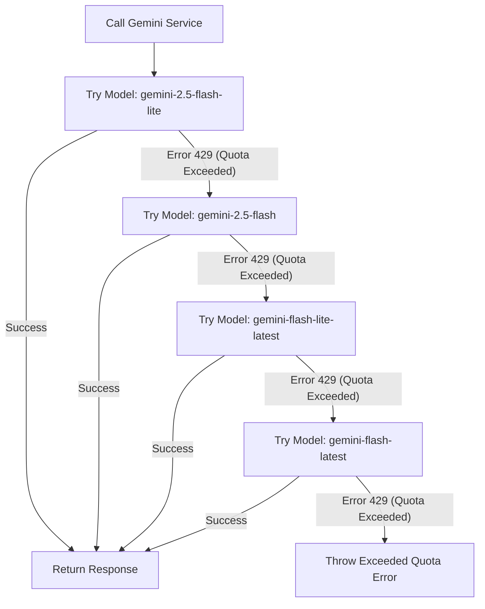

# CryptoSynapse: Architecture & Design Guide

This document describes the system architecture, database schema, data flows, and specialized services integration within the **CryptoSynapse** application.

---

## 1. System Architecture Overview

CryptoSynapse follows a classic three-tier web application architecture:
1.  **Frontend Client**: React Single Page Application (SPA) built using Vite, styled with CSS + Tailwind CSS, and localized using React `i18next`. It uses Recharts for data visualization, including overlaid price/sentiment correlation charts.
2.  **Backend Server**: Node.js + Express web API built in TypeScript. Operates both routing handlers for Client requests and scheduled background services.
3.  **Database Layer**: PostgreSQL database managed via Prisma ORM for type-safe models and schema migrations.

```mermaid
graph TD
    %% Frontend Node
    Client["React + Vite Frontend (Port 5173)"]
    
    %% Backend Node
    subgraph Express Backend (Port 5001)
        API["Express Router"]
        Scheduler["Background Scheduler (setInterval)"]
        CGService["CoinGecko Service"]
        NewsService["RSS & Google News Service"]
        NotiService["Notification Service (w/ Retry Logic)"]
        GeminiService["Gemini AI Service"]
    end
    
    %% Database Node
    DB[("PostgreSQL DB (Port 5432)")]
    Prisma["Prisma ORM Client"]

    %% External Interfaces
    CGAPI["CoinGecko API (Prices)"]
    RSSFeed["CoinDesk RSS / Google News RSS"]
    GeminiAPI["Google Gemini API (AI Models)"]
    SMTP["SMTP Mail Server"]
    TelegramAPI["Telegram Bot API"]

    %% Connections
    Client -- HTTP Requests --> API
    API -- Read/Write --> Prisma
    Prisma --> DB
    
    Scheduler --> CGService
    Scheduler --> NewsService
    
    CGService -- Fetches Prices --> CGAPI
    CGService -- Query/Update --> Prisma
    CGService -- Alerts Cross Check --> NotiService
    
    NewsService -- Parses Ingestion --> RSSFeed
    NewsService -- Uses for Summaries/Sentiment/Companion --> GeminiService
    NewsService -- Persists --> Prisma
    
    GeminiService -- Structured Prompting --> GeminiAPI
    
    NotiService -- Sends Email Alerts --> SMTP
    NotiService -- Sends Telegram Bot alerts --> TelegramAPI
```

---

## 2. In-Depth Ingestion & Services Workflow

### A. Background Price Sync (CoinGecko Integration)
*   **Trigger**: Fires immediately on server startup, then runs on a background scheduler loop every **5 minutes** (`300,000 ms`).
*   **Process**:
    1.  Queries the database for all tracked `Coin` entries. If empty, the execution exits early.
    2.  Compiles target coin IDs and requests their latest prices and 24h changes from the CoinGecko API.
    3.  Iterates through returned items, updates database records (`currentPrice`, `priceChange24h`, and `updatedAt`).
    4.  Fires **Alert Evaluation Logic** for each coin.

### B. Price Alert Triggering Logic
*   Alerts are active target prices created by authenticated users.
*   Upon saving a new price update, the service queries all untriggered alerts (`isTriggered: false`) matching the updated coin ID.
*   **Crossing Threshold Condition**:
    *   To prevent simple high/low boundaries from firing prematurely, the logic tracks the *previous* price (`oldPrice`) and compares it against the *new* price (`price`):
        *   **Rose Above**: `oldPrice < target && price >= target`
        *   **Dropped Below**: `oldPrice > target && price <= target`
    *   If either crossing condition is met, the alert is updated in the database to `isTriggered: true` and a message is immediately dispatched to the `NotificationService`.
*   **Notifications & Retry Logic**:
    *   To prevent failed messages from dropping silently, the system employs an asynchronous delay-based retry pattern.
    *   If a Telegram or SMTP delivery fails, it retries up to 3 times (with a 2-second delay).
    *   The database `deliveryStatus` field is then updated to either `DELIVERED` or `FAILED`, allowing the UI to display accurate badge indicators.

### C. News Ingestion & Gemini NLP Processing
*   **Default Feed**: Fetches CoinDesk RSS feed immediately on startup, and then updates every **15 minutes** (`900,000 ms`).
*   **NLP Analysis Integration**:
    1.  The latest 10 articles are retrieved from RSS. Existing URLs are automatically ignored to avoid duplication.
    2.  For new items, the system scans title and content snippets against active database coins to create relationships (`coinId`).
    3.  Title and content are sent to the **Gemini AI Service** using a structured schema requesting a concise summary in Polish and a 5-level market sentiment rating:
        *   `STRONG_POSITIVE` (Halving events, spot ETF approval)
        *   `MODERATE_POSITIVE` (Successful upgrades, network integrations)
        *   `NEUTRAL` (Standard technical updates, scheduled maintenance)
        *   `MODERATE_NEGATIVE` (Delays, minor technical corrections, regulator warnings)
        *   `STRONG_NEGATIVE` (Major protocol hacks, bankruptcies, government bans)
    4.  If the Gemini analysis fails, the system safely falls back to a default `NEUTRAL` sentiment and a truncated snippet summary to ensure the server remains stable.

### D. AI Trading Companion & Deep Research
*   **AI Trading Companion**: Evaluates a cluster of recent news items and general market data for a specific coin. Generates a "Risk Score" and actionable insights by querying Gemini with a heavy analytical prompt.
*   **On-demand Deep Research**: Scans Google News RSS for customized target keywords and queries, utilizing an AI-based crypto-relevance gate to filter out non-crypto content, summarize findings, and run sentiment analysis.

---

## 3. Gemini AI Resiliency & Fallback Protocol

To handle rate limits (429 quota exceptions), the `geminiService.ts` implements a resilient automatic model fallback chain.



### Automatic JSON Validation
When requesting sentiment and summary analysis, the backend forces structured responses from the Gemini API using `generationConfig: { responseMimeType: 'application/json' }`.
The schema returned is strictly validated:
```json
{
  "summary": "Polish text (1-2 sentences)",
  "sentiment": "STRONG_POSITIVE | MODERATE_POSITIVE | NEUTRAL | MODERATE_NEGATIVE | STRONG_NEGATIVE"
}
```

---

## 4. Multi-Language (i18n) & Caching Architecture

*   **i18next Localizations**: The frontend supports three languages: Polish (`pl`), English (`en`), and Ukrainian (`uk`).
*   **AI Context Expansion & Translations**:
    1.  When a user views an article and clicks "AI Analysis (Expand)", the frontend hits `POST /api/news/:id/expand` passing the target user language.
    2.  The backend calls Gemini to generate a bulleted analysis matching that specific language.
    3.  To prevent duplicate API charges, the expanded text is cached directly inside the `Article.expandedContent` database column. Subsequent user requests immediately return this cached value.
    4.  For localized summaries, the frontend automatically translates Polish news summaries into the client's current language (`en` or `uk`) using the Gemini translation route `POST /api/news/translate`, caching the result in frontend state (`translatedSummaries`).

---

## 5. Database Entity Relationships (Prisma Schema)

The PostgreSQL schema consists of four core tables:

```text
  +-------------------+              +-------------------+
  |       User        |              |       Coin        |
  +-------------------+              +-------------------+
  | id (UUID)         |              | id (String, Pkey) |
  | email (String)    |<---+         | symbol (String)   |<---+
  | passwordHash      |    |         | name (String)     |    |
  | telegramChatId    |    |         | currentPrice      |    |
  | notificationEmail |    |         | priceChange24h    |    |
  | createdAt         |    |         | updatedAt         |    |
  +-------------------+    |         +-------------------+    |
                           |                                  |
                           |                                  |
  +-------------------+    |         +-------------------+    |
  |       Alert       |    |         |      Article      |    |
  +-------------------+    |         +-------------------+    |
  | id (UUID)         |    |         | id (UUID)         |    |
  | userId (Fkey)     |----+         | title (String)    |    |
  | coinId (Fkey)     |--------------| content (Text)    |    |
  | targetPrice       |              | url (String)      |    |
  | isTriggered       |              | summary (Text)    |    |
  | deliveryStatus    |              | sentiment (String)|    |
  | createdAt         |              | expandedContent   |    |
  +-------------------+              | publishedAt       |    |
                                     | coinId (Fkey)     |----+
                                     +-------------------+
```

*   **Cascade Deletion Rules**:
    *   If a `User` account is deleted, all their related `Alert` entries are cascade deleted.
    *   If a `Coin` is deleted, all associated `Alert` items and dynamic `Article` news entries linked to it are cascade deleted.

---

## 6. Key Backend API Endpoints

### Authentication `/api/auth`
*   `POST /register`: Registers a new user.
*   `POST /login`: Authenticates user credentials.
*   `GET /me`: Fetches profile details of current user.
*   `PUT /profile`: Updates Telegram Chat ID and notification settings.

### Cryptocurrency Assets `/api/coins`
*   `GET /`: Returns list of all tracked coin assets.
*   `GET /search?query=...`: Queries CoinGecko Search API.
*   `POST /`: Adds a new coin to database.
*   `DELETE /:id`: Removes a coin and its associated relations.

### Price Alerts `/api/alerts`
*   `GET /`: Returns list of all alerts created by the current user.
*   `POST /`: Configures a new target price alert trigger.
*   `DELETE /:id`: Deletes a price alert.

### Ingested News `/api/news`
*   `GET /?filter=all|watchlist|coinId`: Retrieves latest articles.
*   `POST /translate`: Dynamically translates news summaries.
*   `POST /:id/expand`: Generates/reads database cached expanded context.
*   `POST /deep-research`: Ingests real-time Google News RSS based on criteria.

### AI Engine `/api/ai`
*   `POST /companion-analysis`: Generates AI Trading Companion reports based on market state.
